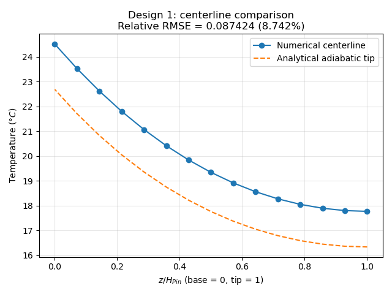
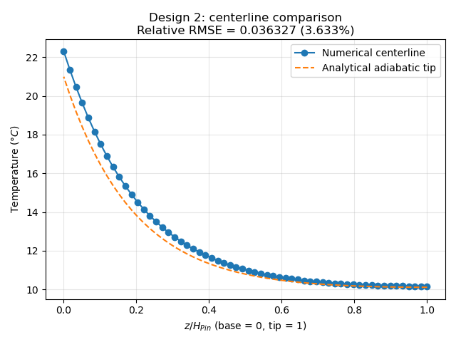
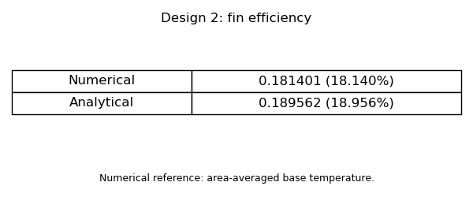
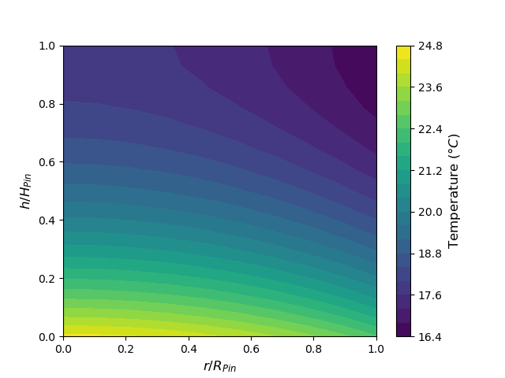
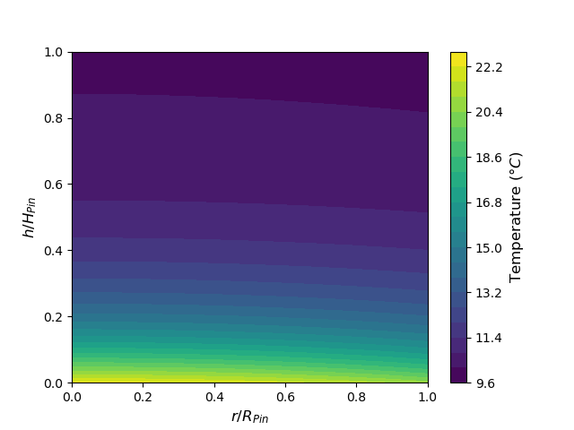
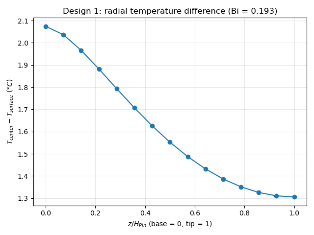
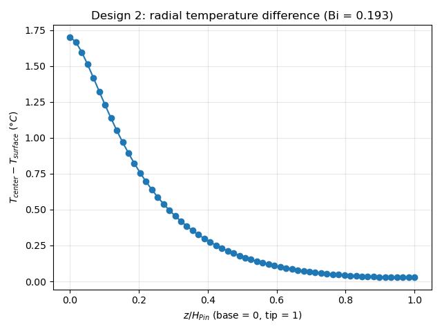
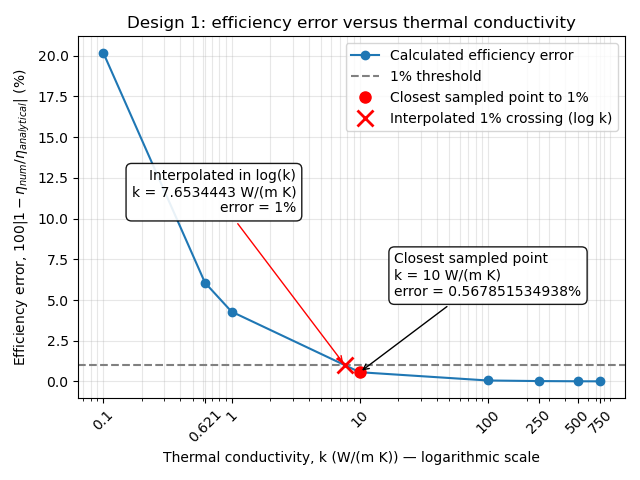

# EME 165, Fall 2026

From: Atharva Kharwadkar  
Date: 6 November 2026

## Introduction:

Simulating the heat transfer in cylindrical pin fins by radial discretization; we obtain a 2D surface representing nodes that span the height and radius of the cylinder, from center to edge. There are 9 types of nodes, all derived in part 1 of the project, providing the temperature of a node as a function of the temperature of nodes surrounding it.

## Parameters:

$$
\alpha_1 = 0.75 \qquad \alpha_2 = 3 \qquad D_{pin} = 1.2 \times 10^{-3}\ m
$$

$$
K_{resin} = 0.621\ W/(mK) \qquad q_{flux} = 10{,}000\ W/m^2 \qquad h_o = 400\ W/(m^2K)
$$

$$
T_\infty = 10\ ^\circ C
$$

## Results:

### Q1: Centerline Temperature Distribution

By modifying the iterative solver in [F26_Project_Template_Iterative.py](templates/F26_Project_Template_Iterative.py), we obtain temperatures at each node along the centerline by picking out every row, :, in the first column, 0, of the 2D array which defines the contour map, temp_map1[: , 0].



**Figure 1A:** Centerline Comparison Numerical vs Analytical for Design 1



**Figure 2A:** Centerline Comparison Numerical vs Analytical for Design 2

Figures 1A and 2A display a non-negligible deviation in the numerical solution from the analytical solution, though Design 2 aligns better than Design 1. In both cases, the numerical centerline is noticeably hotter than the analytical prediction. This difference can be attributed to a 1D theoretical model compared to a 2D physical reality. The 1D model neglects the radial temperature gradient, displayed in the absence of an (r) term in the analytical temperature distribution equation for an adiabatic tip. This theoretical distribution is derived from the adiabatic tip condition (Case B in Lecture 9), where

$$
\frac{\theta}{\theta_b} = \frac{\cosh[m(L-x)]}{\cosh(mL)}
\qquad \text{and} \qquad q_f = M\tanh(mL).
$$

By equating $q_f$ to the applied base heat flux multiplied by the base area and rearranging the terms to isolate $\theta_b$, we substitute $\theta = T(z) - T_\infty$ to yield the final simplified equation:

$$
T(z) = T_\infty + \frac{q''}{km}\frac{\cosh[m(H-z)]}{\sinh(mH)}
$$

On the other hand, the 2D model captures the actual physical behavior by explicitly including the (r) term in the nodal equations (as seen in the Appendix). The model takes into account the radial temperature gradient and demonstrates the heat getting trapped closer to the centerline. This bottleneck explains why the numerical model consistently calculates a higher centerline temperature along the height of the fin than the 1D model.

**Code Block 1:** Determining the RMSE using numpy and the centerline plot’s data

```python
relative_rmse = np.sqrt(np.mean((1 - T_centerline/T_analytical)**2))
```

Next, the RMSE for each centerline comparison plot is calculated within the solver using the code above. This returned 8.74% and 3.63% for Design 1 and Design 2 respectively. This shows that the computed centerline for Design 2 agrees more closely with the analytical adiabatic-tip prediction than Design 1.

### Q2: Fin Efficiency Numerically vs. Analytically

The Analytical Equation:

$$
\eta_{analytical} = \frac{\tanh(mH)}{mH}
$$

The Numerical Equation:

$$
\eta_{numerical} = \frac{Q_{actual}}{h(2\pi RH)(T_b-T_\infty)}
$$

The analytical equation applies to an adiabatic pin fin where $m = \sqrt{4h_o/(kD_{pin})}$, and where temperature is expected to only vary axially. The numerical model shares key assumptions like steady-state heat transfer, constant thermal conductivity and convection coefficients, and the adiabatic tip, but it permits radial temperature variation.


**Figure 1B:** Computing $\eta$ for Design 1



**Figure 2B:** Computing $\eta$ for Design 2

The solver is also used to determine the pin efficiency, $\eta$, for both designs. Both methods for $\eta$ were implemented to provide a comparison of the disparity between the analytically and numerically computed efficiencies. As a result, this practice highlighted a greater disagreement between computed efficiencies for Design 1 (6.46%) than Design 2 (4.5%).

Neither numerical solution agrees wholly with its analytical counterpart, and what’s even more striking is that both analytical solutions slightly overestimate the efficiency of the pin fins. This overestimation is consistent with models that neglect radial temperature gradients.

What’s more is that Design 1 is significantly more efficient that Design 2, though this doesn’t really automatically confirm that Design 1 transfers more heat, but rather that it makes better use of its surface area.

### Q3: Biot Number Implications

The Biot Number establishes whether we can interpret the problem under a radially lumped assumption. Doing so would enable us to assume the pin fin as an object where internal temperatures vary axially, and with no regard for radial location.

Biot Number,

$$
Bi = \frac{hR}{2k}; \qquad \text{for both Design 1 and 2,}\qquad
Bi = \frac{400(0.0006)}{2(0.621)} = 0.1932 > 0.1;
$$

In this case, the radial lumping criterion is not met. For these pin fins, computing the temperature of an object is not straightforward. We must account for the internal radial temperature gradients.



**Figure 1C:** Contour plot for Design 1



**Figure 2C:** Contour plot for Design 2

The contour plots which correspond to the entirety of the 2D surface show that temperature certainly varies radially. Radial temperature variation is more apparent in Design 1, and this is likely a contributing factor for the heightened disparity from the analytically determined fin efficiency for Design 1.

This notion is expected and was repeatedly signaled by observations that preceded Q3 in Q1 and Q2. In those sections, numerical solutions to Design 2 frequently aligned with its analytical counterpart much more closely than Design 1. If we look at Design 2’s contour plot, we can see contour shapes that slightly resemble purely axial internal temperature gradients, whereas in Design 1, a radial internal temperature gradient clearly exists.

This elucidated even further by the following figures, 1D and 2D. The reduction in radial temperature difference between the center and surface drops much more steeply in design 2.



**Figure 1D:** Radial difference of T



**Figure 2D:** Radial difference of T

### Q4: Different conductivities and Material Selection

Assuming the same airflow conditions and dimensions from Design 1, an estimated thermal conductivity for the fin to achieve the lumped capacity assumption and act as a theoretical adiabatic tip pin-fin is $k \approx 7.65\ W/(m\cdot K)$, because at this value the interpolated error between the numerical efficiency and theoretical analytical efficiency is 1%.



**Figure 1E:** Efficiency error versus thermal conductivity

Because the x-axis of this graph is on a logarithmic scale, this value was found through logarithmic interpolation between the efficiency error at ($k = 1\ W/(m\cdot K) \approx 4.29\%$) and ($k = 10\ W/(m\cdot K) \approx 0.57\%$).

Next, checking the Biot number of this new conductivity with the same parameters as before ($h = 400\ W/m^2K$, $R = 0.0006\ m$) results in $Bi \approx 0.0157$. This value is well below the 0.1 threshold, supporting the assumption that the radial temperature gradients have become negligible.

In the future, Design 1 should be manufactured from Aluminum, which has a thermal conductivity of around $180\ W/mK$. This comfortably exceeds the $7.65\ W/mK$ requirement, which guarantees that the design will act as a theoretical adiabatic tip pin-fin.


## Repository layout

```text
assets/          Figures referenced in this writeup
scripts/         Design 1, Design 2, and conductivity-sweep solvers
templates/       Original course solver template
README.md        Project writeup and usage
requirements.txt Python dependencies
```

## Running the code

From the repository root, create a local Conda environment and install the dependencies:

```bash
conda create --prefix ./.conda python=3.11 pip -y
conda activate ./.conda
python -m pip install -r requirements.txt
```

If the local `.conda` environment already exists, activate it and run the desired script:

```bash
python scripts/design1.py
python scripts/design2.py
python scripts/design1_kiterations.py
```

Select `.conda/bin/python` as the interpreter in your IDE. Each script displays its figures and prints the calculated results.
